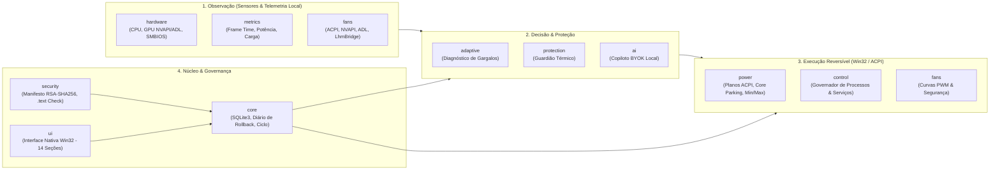

<div align="center">


# ⚡ OPIT-CORE

### Motor Adaptativo de Hardware, Desempenho, Energia e Governança Térmica para Windows

[](LICENSE)
[](CMakeLists.txt)
[-0078D6?style=for-the-badge&logo=windows&logoColor=white)](#requisitos-e-compatibilidade)
[](#suíte-de-testes-e-verificação)
[-critical?style=for-the-badge)](#privacidade-e-segurança-defensiva)

**Código-fonte disponível (*Source-Available*) sob `PolyForm Strict 1.0.0` • Uso pessoal não comercial gratuito • Sem ativação • Sem telemetria.**

[Como Baixar e Usar](#-como-baixar-e-usar-no-windows-guia-completo-e-arquivos-necessários) •
[Por que Código Disponível?](#-por-que-o-opit-core-tem-código-disponível-sob-polyform-strict-100) •
[Arquitetura e Módulos](#-arquitetura-e-módulos) •
[Diferenciais Técnicos](#-três-compromissos-de-engenharia) •
[Como Compilar](#-como-compilar-do-código-fonte) •
[Licença e Marcas](#-licença-marcas-e-direitos) •
[Apoie (PIX)](#-apoie-o-projeto-donationware)

</div>

---

## 🚀 Como Baixar e Usar no Windows (Guia Completo e Arquivos Necessários)

### Passo a Passo Rápido (Versão Pronta em Releases)
1. Acesse a aba **[Releases](../../releases)** aqui no repositório do GitHub.
2. Em **Assets** (no final da página da versão `v8.2.0`), baixe o pacote correspondente ao seu sistema:
   - **`Opit-Core-8.2.0-x64.zip`** *(Windows de 64 bits — Recomendado)*
   - **`Opit-Core-8.2.0-x86.zip`** *(Windows de 32 bits)*
3. **Extraia (descompacte) TODOS os arquivos do `.zip` juntos na mesma pasta** (ex.: `C:\Opit-Core\`). **Não tire o `Opit-Core.exe` de dentro da pasta sozinho**, pois ele precisa das DLLs que estão ao lado dele.
4. Clique com o botão direito em **`Opit-Core.exe`** e selecione **"Executar como Administrador"** *(necessário para ajustar planos de energia ACPI e serviços do Windows)*.
   - *Aviso do Windows SmartScreen:* Como o software é gratuito e independente, o Windows pode exibir a tela azul *"O Windows protegeu o seu computador"*. Clique em **"Mais informações"** e depois em **"Executar assim mesmo"**.
5. **Para sair totalmente:** Clicar no `X` minimiza o programa para a bandeja do sistema (ao lado do relógio) para manter a proteção ativa. Para encerrar e restaurar as configurações originais do Windows, clique com o botão direito no ícone da bandeja e escolha **"Sair"**.

---

### 📦 Arquivos da Microsoft e de Terceiros: O que não vem de fábrica no Windows e onde colocar?

Para que o **Opit-Core** rode em qualquer computador sem dar erro de *"DLL ausente"* (como `VCRUNTIME140.dll não foi encontrado` ou `ucrtbase.dll ausente`), os arquivos abaixo devem ficar **exatamente na mesma pasta onde está o `Opit-Core.exe`** (no pacote `.zip` da aba *Releases* eles já vêm colocados no lugar certo; se você compilar o código-fonte do zero, veja onde obtê-los e onde colocá-los):

#### 1. Runtime Visual C++ da Microsoft (Não vem de fábrica em instalações limpas do Windows 10 / 11 / 8.1 / 7)
O Windows recém-formatado não traz as bibliotecas do Visual Studio 2022 instaladas por padrão. Você tem duas opções:
- **Opção A (Portátil — sem instalar nada no Windows):** Coloque estas **3 DLLs da Microsoft na mesma pasta do `Opit-Core.exe`** *(já incluídas no `.zip` de Release)*:
  - `MSVCP140.dll` *(Biblioteca padrão C++ da Microsoft)*
  - `VCRUNTIME140.dll` *(Runtime C do Visual Studio)*
  - `VCRUNTIME140_1.dll` *(Tratamento de exceções C++ x64 — necessário apenas na versão 64 bits)*
  - *Onde encontrar se você compilou do zero:* Em `C:\Windows\System32\` (para 64 bits) ou `C:\Windows\SysWOW64\` (para 32 bits), ou na pasta `VC\Redist\MSVC\` do Visual Studio.
- **Opção B (Instalador Oficial da Microsoft):** Se preferir instalar no sistema operacional (`C:\Windows\System32`), baixe e instale o pacote oficial gratuito **[Microsoft Visual C++ Redistributable 2015–2022](https://learn.microsoft.com/pt-br/cpp/windows/latest-supported-vc-redist)** (`vc_redist.x64.exe` para 64 bits ou `vc_redist.x86.exe` para 32 bits).

#### 2. Universal C Runtime — UCRT (Vem de fábrica no Windows 10 e 11, mas NÃO vem no Windows 7 SP1 / 8.1)
Nos sistemas **Windows 7 SP1** e **Windows 8.1**, a Microsoft não incluía o Universal CRT de fábrica. Para funcionar nesses sistemas sem depender do Windows Update, coloque estas **10 DLLs diretamente na mesma pasta do `Opit-Core.exe`** *(já incluídas no `.zip` de Release)*:
- `ucrtbase.dll`
- `api-ms-win-crt-convert-l1-1-0.dll`
- `api-ms-win-crt-filesystem-l1-1-0.dll`
- `api-ms-win-crt-heap-l1-1-0.dll`
- `api-ms-win-crt-locale-l1-1-0.dll`
- `api-ms-win-crt-math-l1-1-0.dll`
- `api-ms-win-crt-runtime-l1-1-0.dll`
- `api-ms-win-crt-stdio-l1-1-0.dll`
- `api-ms-win-crt-string-l1-1-0.dll`
- `api-ms-win-crt-time-l1-1-0.dll`
- *Onde encontrar se você compilou do zero:* No Windows 10 SDK em `C:\Program Files (x86)\Windows Kits\10\Redist\ucrt\DLLs\x64\` (ou `\x86\`).

#### 3. Microsoft .NET Framework 4.8 (Vem de fábrica no Windows 10 e 11, mas NÃO vem no Windows 7 SP1 / 8.1)
A ponte de leitura de sensores da placa-mãe (`opitcore_lhm_bridge.dll`) utiliza o `.NET Framework 4.8`:
- **No Windows 10 (versão 1903+) e Windows 11:** Já vem instalado de fábrica no sistema operacional (não precisa fazer nada).
- **No Windows 7 SP1 e Windows 8.1:** Não vem de fábrica. É necessário baixar e instalar o **[Microsoft .NET Framework 4.8 Runtime](https://dotnet.microsoft.com/pt-br/download/dotnet-framework/net48)** oficial da Microsoft antes de abrir o programa.

#### 4. Bibliotecas de Sensores de Placa-Mãe (`LibreHardwareMonitor` — Não vêm no Windows nem no código-fonte puro do GitHub)
Por regras de licenciamento do GitHub, o código-fonte do repositório não armazena DLLs compiladas de terceiros. Para que a leitura avançada de sensores Super I/O de placa-mãe funcione (em 64 bits), estes **10 arquivos devem ficar na mesma pasta do `Opit-Core.exe`** *(todos já vêm prontos dentro do `Opit-Core-8.1.2-x64.zip` na aba Releases)*:
- `opitcore_lhm_bridge.dll` *(Ponte C++/CLI compilada pelo projeto)*
- `LibreHardwareMonitorLib.dll` *(Motor de sensores MPL-2.0)*
- `HidSharp.dll`, `DiskInfoToolkit.dll`, `RAMSPDToolkit-NDD.dll`, `BlackSharp.Core.dll`
- `System.Buffers.dll`, `System.Memory.dll`, `System.Numerics.Vectors.dll`, `System.Runtime.CompilerServices.Unsafe.dll`

### Resumo Visual: Como deve ficar a pasta do programa para funcionar sem erros

```text
📁 Sua-Pasta-do-Opit-Core/
 ├── 🚀 Opit-Core.exe                                  <-- Executável principal (Mantenha junto com as DLLs abaixo!)
 ├── 📜 opit_manifest.json / opit_manifest.sig         <-- Manifesto assinado de integridade dos arquivos
 │
 ├── 🏢 [Arquivos da Microsoft — Visual C++ Runtime]   <-- Devem ficar na mesma pasta do .exe (ou em C:\Windows\System32)
 │    ├── MSVCP140.dll
 │    ├── VCRUNTIME140.dll
 │    └── VCRUNTIME140_1.dll                           (Apenas na versão x64)
 │
 ├── 🏢 [Arquivos da Microsoft — Universal CRT / UCRT] <-- Devem ficar na mesma pasta do .exe para compatibilidade total
 │    ├── ucrtbase.dll
 │    └── api-ms-win-crt-*.dll                         (9 arquivos api-ms-win-crt-*-l1-1-0.dll)
 │
 └── 🌡️ [Arquivos de Sensores — Ponte LhmBridge x64]   <-- Devem ficar na mesma pasta do .exe (versão x64)
      ├── opitcore_lhm_bridge.dll
      ├── LibreHardwareMonitorLib.dll
      ├── BlackSharp.Core.dll / DiskInfoToolkit.dll / HidSharp.dll / RAMSPDToolkit-NDD.dll
      └── System.Buffers.dll / System.Memory.dll / System.Numerics.Vectors.dll / System.Runtime.CompilerServices.Unsafe.dll
```

---

## 🎯 O que é o Opit-Core?

O **Opit-Core** é um orquestrador nativo em **C++17 / Win32** (~28,5 mil linhas de código, zero dependências de frameworks pesados de UI) que ajusta em tempo real os planos de energia (ACPI/PPM), limites de frequência de CPU, *core parking*, prioridades de processos, estados de serviços do Windows e curvas de ventoinhas.

Diferente de "otimizadores" que aplicam tweaks cegos no Registro do Windows e deixam o sistema instável, o Opit-Core opera em **malha fechada**: ele mede a temperatura, a carga real de CPU/GPU/RAM/E/S, o tempo de quadro (*frame time*) e o custo de cada transição — **e reverte absolutamente tudo ao estado original exato quando você fecha o programa**.

> [!IMPORTANT]
> **Natureza Não-Overclocking (Segurança de Silício):** O Opit-Core **não** faz overclocking nem *overvolting*. Ele opera estritamente dentro dos parâmetros nominais de fábrica (*stock*) fornecidos pelos fabricantes (Intel, AMD, NVIDIA, Microsoft) via APIs nativas do Windows e dos drivers oficiais.

---

## 🔓 Por que o Opit-Core tem código disponível sob PolyForm Strict 1.0.0?

O Opit-Core nasceu originalmente como um software comercial fechado: exigia login, validava assinatura em servidor remoto, vinculava a licença ao hardware (*fingerprint*) e bloqueava recursos. Em novembro de 2026, toda essa camada de restrição e comunicação com servidores foi **definitivamente arrancada da árvore de código**.

A razão dessa decisão é direta e transparente: **na era atual da Inteligência Artificial, a obscuridade de binários deixou de existir.** Tentar proteger um software local com DRM invasivo só prejudica o usuário legítimo. Ao mesmo tempo, liberar o código sob licenças permissivas permite que terceiros redistribuam, modifiquem ou vendam o trabalho alheio.

Por isso, adotamos o modelo **Source-Available** com a **[PolyForm Strict License 1.0.0](LICENSE)**:

- **100% transparente e gratuito para uso pessoal/não comercial:** Qualquer pessoa (para uso pessoal, estudo, testes ou hobby) e instituições sem fins lucrativos, educacionais ou governamentais podem baixar, usar e auditar o código-fonte (confirmando zero telemetria) sem pagar nada.
- **Proteção comercial e autoral máxima:** Terceiros **não podem usar comercialmente**, **não podem redistribuir** e **não podem criar versões modificadas ou derivadas**. **Somente a ACSTC Lab** tem o direito de comercializar, distribuir oficialmente e licenciar o Opit-Core e o ecossistema `OPIT`.

**Gratuito para uso pessoal não comercial e *donationware*.** Não existe telemetria nem trava escondida.

---

## 🧩 Arquitetura e Módulos

O projeto é dividido em **13 subsistemas modulares** em `src/`, desenhados com separação estrita entre **Observação → Decisão → Execucao → Prova de Reversão**:



| Módulo (`src/`) | Responsabilidade na Prática |
| :--- | :--- |
| **`core`** | Orquestrador central, ciclo de decisão determinístico, configuração persistida em **SQLite3** embutido e diário transacional de recuperação (*rollback journal*). |
| **`adaptive`** | Diagnostica em tempo real o gargalo dominante (CPU, GPU, Memória, E/S ou Térmico) e seleciona a política ideal com histerese para evitar oscilações. |
| **`power`** | Controle nativo de planos de energia do Windows (ACPI/PPM), limites Min/Max de processador para Tomada (AC) e Bateria (DC), e desbloqueio controlado de *Core Parking*. |
| **`control`** | Governador de prioridade de processos (com proteção de processos críticos do sistema) e governador de serviços do Windows com orçamento de impacto e trava anti-vaivém. |
| **`hardware`** | Reconhecimento profundo de hardware: topologia de CPU, telemetria de GPU (NVIDIA NVAPI / AMD / Intel) e leitura direta de tabelas **SMBIOS** (placa-mãe, BIOS e pentes de RAM). |
| **`fans`** | Controle de curvas de ventoinhas com histerese e controlador de segurança; suporta ACPI/WMI, NVIDIA NVAPI, AMD ADL, Intel e ponte opcional `LhmBridge` para Super I/O. |
| **`protection`** | Guardião térmico autônomo: monitora limites críticos de temperatura, aplica degradação progressiva de potência para proteger o hardware e restaura após o resfriamento. |
| **`metrics`** | Função-objetivo medida diretamente no sistema real (tempo de quadro DWM/DXGI, consumo de GPU em Watts, utilização por núcleo e pressão de memória). |
| **`platform/windows`** | Camada de abstração Win32: WMI, Service Control Manager (SCM), Registro transacional, APIs `Power*`, Agendador de Tarefas e verificação de elevação UAC. |
| **`security`** | Verificação defensiva de integridade: manifesto assinado (`RSA-SHA256`), checksum em memória da seção `.text`, mitigação contra *DLL Hijacking* e sanitização de logs locais. |
| **`ai`** | Copiloto de diagnóstico técnico estilo *BYOK (Bring Your Own Key)*: funciona exclusivamente se você digitar a **sua própria chave de API**, sem intermediários. |
| **`ui`** | Interface gráfica Win32 pura e ultraleve: 14 seções especializadas, Painel Unificado de Configurações, suporte a DPI *PerMonitorV2*, tema escuro e bandeja do sistema (*system tray*). |
| **`utils`** | Utilitários de alta performance, manipulação segura de strings UTF-8/UTF-16 e helpers de concorrência. |

---

## 🛡️ Três Compromissos de Engenharia

1. **Nada é feito às cegas (Execução Baseada em Evidência):**
   Cada decisão lê o estado real do sistema operacional **antes** e **depois** da chamada de API. Se uma alteração não puder ser comprovada pela leitura posterior, ela é classificada como *não provada* nos relatórios locais, nunca como um falso sucesso.
2. **Tudo é 100% reversível (Restauração Transacional):**
   Antes de tocar em qualquer plano de energia, prioridade de processo ou serviço, o estado original é gravado no diário de recuperação. Ao fechar o Opit-Core (ou mesmo na inicialização seguinte após uma queda de energia), o estado exato de origem é restaurado — uma chave que não existia volta a não existir.
3. **Zero Telemetria (Privacidade Absoluta por Design):**
   O Opit-Core **não coleta dados**, não possui analytics oculto e não conversa com servidores da ACSTCLab. Além disso, os logs gerados localmente na sua máquina passam por um sanitizador automático que mascara caminhos de pastas contendo o seu nome de usuário (`C:\Users\<usuario>`), permitindo compartilhar logs em *issues* do GitHub com segurança.

---

## 🔒 Privacidade e Segurança Defensiva

O módulo `src/security/` permanece ativo na versão de código disponível (*Source-Available*) com uma filosofia clara: **informar e proteger o usuário contra adulterações de terceiros, nunca bloquear o uso legítimo.**

- **Prevenção contra Sequestro de DLL (*DLL Search Order Hijacking*):** Endurecimento imediato da ordem de busca de bibliotecas dinâmicas no início de `wWinMain`.
- **Control Flow Guard (`/guard:cf`), ASLR (`/DYNAMICBASE`), DEP (`/NXCOMPAT`) e Stack Canaries (`/GS`):** Habilitados por padrão na compilação MSVC.
- **Baseline de Memória (`.text`) e Manifesto Criptográfico (`RSA-SHA256`):** Detecta se binários pré-compilados foram corrompidos ou infectados após o build e registra nos diagnósticos locais. Em builds comunitários feitos a partir do código-fonte sem a chave privada da ACSTCLab, o programa compila e roda livremente sem qualquer bloqueio.

---

## 🛠️ Como Compilar do Código-Fonte

### Requisitos e Compatibilidade

- **Sistema Operacional:**
  - **Windows 10 e Windows 11 (x64 e x86):** Totalmente suportados e testados.
  - **Windows 7 SP1 e Windows 8.1:** Compatíveis a nível de binário (o SQLite3 é compilado junto ao executável sem depender de `winsqlite3.dll`, e APIs modernas do DWM são resolvidas dinamicamente em tempo de execução).
- **Ferramentas de Compilação:**
  - **Visual Studio 2022** (ou *Build Tools for Visual Studio 2022*) com a carga de trabalho *"Desenvolvimento para desktop com C++"* (MSVC C++17 e Windows 10/11 SDK).
  - **CMake 3.16** ou superior.

### Passo a Passo (PowerShell / Prompt de Comando)

#### 1. Compilar para 64 bits (x64 — Recomendado)
```powershell
cmake -S . -B build -G "Visual Studio 17 2022" -A x64
cmake --build build --config Release -j 8 -- /nodeReuse:false
```
O executável final estará em: `build\Release\Opit-Core.exe`

#### 2. Compilar para 32 bits (x86)
```powershell
cmake -S . -B build-x86 -G "Visual Studio 17 2022" -A Win32
cmake --build build-x86 --config Release -j 8 -- /nodeReuse:false
```
O executável final estará em: `build-x86\Release\Opit-Core.exe`

> [!TIP]
> **Sensores opcionais via LibreHardwareMonitor (`LhmBridge`):**
> O código-fonte da ponte C++/CLI (`src/fans/lhm_bridge/`) acompanha o repositório. Se você colocar a biblioteca `LibreHardwareMonitorLib.dll` (MPL-2.0) e suas dependências na raiz do projeto antes de rodar o CMake, o alvo `opitcore_lhm_bridge.dll` será compilado e copiado automaticamente. Caso contrário, o CMake compila o `Opit-Core.exe` puro (100% nativo) utilizando os provedores de hardware nativos (ACPI/WMI, NVIDIA NVAPI, AMD ADL e Intel).

---

## 🧪 Suíte de Testes e Verificação

O Opit-Core conta com **23 suítes de testes automatizados** em `tests/`, compiladas como executáveis independentes e orquestradas pelo **CTest**. Nenhuma suíte depende de conexão de rede ou serviços externos:

```powershell
ctest --test-dir build -C Release --output-on-failure
```

As suítes validam:
- Ciclo de vida de configurações, persistência SQLite3 e diário de recuperação (*rollback*);
- Detecção de hardware, topologia de CPU e parser SMBIOS;
- Governadores de planos de energia, prioridades de processos e estados de serviços;
- Cálculo de métricas, função-objetivo, curvas de ventoinhas e controlador de segurança térmica;
- Verificação criptográfica de manifesto, sanitização de privacidade, testes adversariais e responsividade da UI Win32.

---

## 📂 Estrutura do Repositório

```text
Opit-Core/
├── assets/                 # Ícones oficiais (.ico, .png) e recursos visuais
├── docs/                   # Documentação de arquitetura, compilação e avisos de terceiros
├── scripts/                # Script de geração e verificação de manifesto (PowerShell)
├── src/                    # Código-fonte principal C++17 (~28.500 linhas)
│   ├── adaptive/           # Diagnóstico de gargalos e motor de decisão adaptativa
│   ├── ai/                 # Copiloto de diagnóstico local (BYOK)
│   ├── control/            # Governadores de processos e serviços do Windows
│   ├── core/               # Orquestrador, configuração, SQLite e diário de reversão
│   ├── fans/               # Provedores de ventoinhas, curvas PWM e ponte LhmBridge
│   ├── hardware/           # Sondas de CPU, GPU (NVAPI/ADL) e SMBIOS
│   ├── metrics/            # Coleta de métricas reais e função-objetivo
│   ├── platform/windows/   # Integração de baixo nível com APIs Win32, WMI, SCM e ACPI
│   ├── power/              # Gerenciamento de planos de energia e Core Parking
│   ├── protection/         # Guardião térmico e proteção contra superaquecimento
│   ├── security/           # Integridade de binários, proteção de memória e logs sanitizados
│   ├── ui/                 # Interface gráfica nativa Win32 (14 painéis + bandeja)
│   ├── utils/              # Utilitários gerais de sistema e strings
│   ├── main.cpp            # Ponto de entrada (wWinMain), segurança e inicialização
│   └── OpitCore.rc         # Manifesto DPI PerMonitorV2, ícone e metadados de versão
├── tests/                  # 23 suítes de testes automatizados (CTest)
├── third_party/            # Dependências embutidas de código aberto:
│   ├── nlohmann/           # nlohmann/json (MIT License)
│   └── sqlite3/            # SQLite3 Amalgamation (Public Domain)
├── .gitignore              # Regras de exclusão de artefatos de build e chaves locais
├── CMakeLists.txt          # Configuração principal de build (CMake 3.16+)
├── CONTRIBUTING.md         # Regras de contribuição e Acordo de Licença de Contribuidor (CLA)
├── COPYRIGHT.md            # Declaração de autoria, titularidade e cadeia de direitos
├── IP_POLICY.md            # Política de propriedade intelectual e isenção de garantia
├── LICENSE                 # Texto integral da PolyForm Strict License 1.0.0
├── NOTICE                  # Avisos de direitos autorais e família OPIT
├── SECURITY.md             # Política de segurança e verificação de integridade
├── SHA256SUMS.txt          # Hashes SHA-256 oficiais dos pacotes de lançamento
├── THIRD_PARTY_NOTICES.md  # Licenças e avisos de componentes de terceiros
├── TRADEMARKS.md           # Política de marcas da família OPIT e ACSTC Lab
├── VERSION_HISTORY.md      # Histórico oficial de versões e hashes
└── README.md               # Este documento
```

---

## ⚖️ Licença, Marcas e Direitos

```text
Copyright (C) 2026 ACSTC Lab — Alex de Campos Santos Toledo Camilo (alexcstos@gmail.com)
Licensed under PolyForm Strict License 1.0.0 (https://polyformproject.org/licenses/strict/1.0.0)
Official repository: https://github.com/alexcruix/Opit-Core
OPIT Software Family: Opit-Core, Opit-AIEngine, Opit-Graphics, Opit-Graphic, Opit-Grafic, Opit-Sound — ACSTC Lab
```

### Resumo prático da PolyForm Strict License 1.0.0

| ✅ O que você PODE fazer gratuitamente | 🚫 O que é PROIBIDO a terceiros (Exclusivo da ACSTC Lab) |
| :--- | :--- |
| ✔️ **Usar gratuitamente** para fins estritamente **pessoais e não comerciais** (estudo, pesquisa, testes, hobby, entretenimento privado). | ❌ **Proibido qualquer uso comercial** (incluindo venda, assinatura ou uso comercial em empresas sem licença da ACSTC Lab). |
| ✔️ **Usar em instituições sem fins lucrativos**, educacionais, de pesquisa pública ou governamentais. | ❌ **Proibido distribuir ou redistribuir** cópias do programa ou do código-fonte. |
| ✔️ **Ler e auditar** todo o código-fonte para verificar segurança e zero telemetria. | ❌ **Proibido criar versões modificadas ou obras derivadas** baseadas neste código. |
| ✔️ **Compilar para uso pessoal próprio** seguindo o guia de build. | ❌ **Proibido usar as marcas** `"OPIT"`, `"Opit-Core"`, `"Opit-AIEngine"`, `"Opit-Graphics"` / `"Opit-Grafic"`, `"Opit-Sound"`, `"ACSTC Lab"` ou exigir garantias/responsabilização (*No Liability*). |

> [!IMPORTANT]
> **Exclusividade Comercial da ACSTC Lab:** Somente a **ACSTC Lab** tem direito de comercializar, distribuir oficialmente, modificar e conceder licenças comerciais do Opit-Core.
> Consulte a documentação completa de governança: [`LICENSE`](LICENSE) • [`NOTICE`](NOTICE) • [`COPYRIGHT.md`](COPYRIGHT.md) • [`TRADEMARKS.md`](TRADEMARKS.md) • [`IP_POLICY.md`](IP_POLICY.md) • [`SECURITY.md`](SECURITY.md) • [`VERSION_HISTORY.md`](VERSION_HISTORY.md).

> [!NOTE]
> **Licenças de terceiros:** o repositório inclui `nlohmann/json` (**MIT**) e `SQLite3` (**domínio público**). A ponte opcional `LhmBridge` usa a `LibreHardwareMonitorLib` (**MPL-2.0**) em tempo de execução. Veja [`THIRD_PARTY_NOTICES.md`](THIRD_PARTY_NOTICES.md).

---

## 🤝 Como Contribuir

Contribuições são bem-vindas! Antes de abrir um *Pull Request*, leia o [`CONTRIBUTING.md`](CONTRIBUTING.md): ele traz as regras de engenharia do projeto e o **Acordo de Licença de Contribuidor (CLA)**, que precisa ser aceito expressamente no PR.

Em resumo, as regras de engenharia são:

1. **Números e medições, não adjetivos:** documente o estado medido antes e depois, com a mesma métrica.
2. **Prova de reversão obrigatória:** toda alteração de configuração do Windows precisa de reversão exata e de teste em `tests/`.
3. **Ausência declarada:** o que não for medido deve aparecer como *não medido / não suportado*.

---

## 💚 Apoie o Projeto (Donationware)

O **Opit-Core** é 100% gratuito, livre de anúncios, livre de telemetria e sem qualquer recurso bloqueado.

Se o programa ajudou a reduzir a temperatura do seu computador, silenciou suas ventoinhas, economizou bateria ou estabilizou a taxa de quadros dos seus jogos, considere apoiar o desenvolvimento contínuo com uma contribuição voluntária via **PIX**:

<div align="center">

### 💠 Chave PIX (E-mail): `alexcstos@gmail.com`
**Mantenedora:** ACSTCLab

</div>

---

<div align="center">
  <sub>Desenvolvido com rigor em C++17 por <b>ACSTC Lab</b> • Distribuído sob a licença <b>PolyForm Strict 1.0.0</b>.</sub>
</div>
